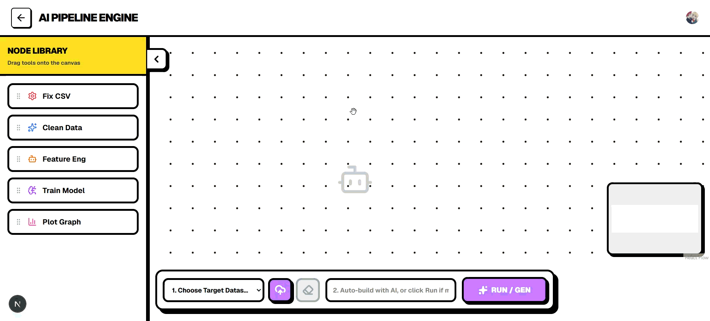
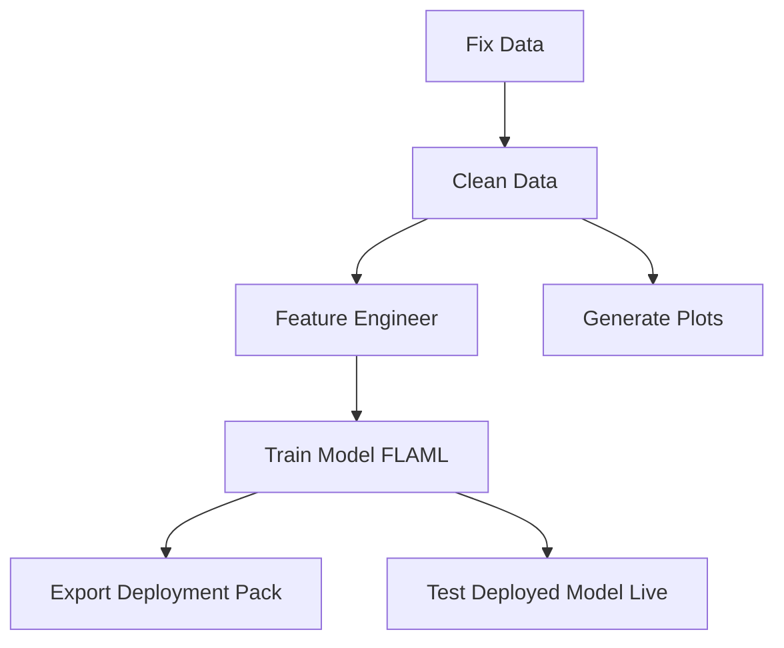
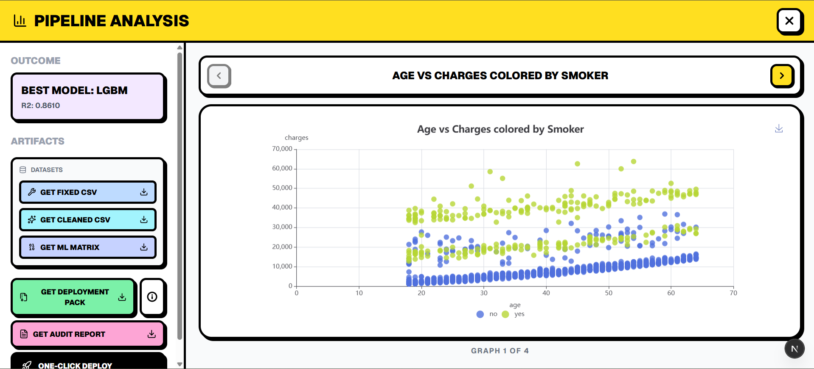

# PROJECT PRISM

> **The Autonomous & Interactive Drag-and-Drop Machine Learning Pipeline Engine**


---

## Demo & Visual Overview

<div align="center">
  
  <br/><br/>
  
  <p><i>Figure 1: Interactive Neo-Brutalist Canvas with Unreal Engine Blueprint-inspired node routing.</i></p>
</div>

---

## What is Project Prism?

**Project Prism** is an open-source Auto-ML engine designed to accelerate data preparation, cleaning, feature engineering, visualization, and model training. Built for both junior ML engineers and seasoned data scientists, Prism provides a **Two-Way Hybrid Architecture**:

1. **Prompt-Driven Mode:** Provide a natural language prompt alongside a raw dataset. Prism autonomously constructs the optimal processing DAG (Directed Acyclic Graph) and executes the pipeline.
2. **Manual Visual Canvas Mode:** Take full granular control. Drag, drop, and connect execution nodes (Fix, Clean, Feature Engineer, Plot, Train) on an interactive 2D canvas inspired by Unreal Engine Blueprints. Adjust node configurations with real-time dynamic column dropdowns.

---

## System Architecture & Workflow Diagrams

Prism decouples high-speed web orchestration, heavy asynchronous compute tasks, and hybrid metadata/object storage.

### 1. Overall System Architecture


### 2. Core ML Processing Pipeline



---

## Core Pipeline Nodes & Functionalities

| Node Name | Key Functionality & Special Capabilities |
| :--- | :--- |
| **Fix Node** | Repairs structurally broken CSVs. Fixes corrupted headers, enforces uniform column counts, and replaces non-standard delimiters (e.g., `\|`, `;`, `\t`) with standard commas (`,`). Supported by LLM fallback diagnosis. |
| **Clean Node** | Powered by **Polars** for multi-threaded speed. Handles custom column dropping, deduplication, mean/median/mode/custom imputation, and **Smart Type Coercion** (e.g., stripping `$` signs from `$2000` to convert object types to true numeric floats). |
| **Plot Node** | Renders 5 interactive **Apache ECharts** (Histogram, Scatter, Bar, Heatmap, Box Plot). Automatically routed *before* feature scaling to preserve human-readable chart scales. Downloadable directly from UI. |
| **Feature Engineer** | Automatically or manually identifies categorical features for One-Hot Encoding and applies Standard or Min-Max scaling to numeric matrices. |
| **Train Node** | Utilizes **FLAML** (Fast & Lightweight AutoML) to find optimal algorithms given a time budget and metric (R², MAE, RMSE, Accuracy, F1). Supports cross-validation or custom train/test CSV splits. |

---

## Live Results, Inference Blueprints & Deployment Pack

Clicking **Run Pipeline** triggers a custom loading interface followed by an interactive, non-blocking **Result Modal**.

```text
┌─────────────────────────────────────────────────────────────────────────┐
│                          PRISM RESULT DASHBOARD                         │
├─────────────────────────────────────────────────────────────────────────┤
│  [Download Fixed CSV]  [Download Clean CSV]  [Download FE CSV]          │
│                                                                         │
│  DEPLOYMENT PACK (.zip)                                                 │
│     ├── model.pkl                 (Trained FLAML Model Artifact)        │
│     └── inference_blueprint.json  (Pipeline Transformation Schema)      │
│                                                                         │
│  LIVE MODEL TESTING ENDPOINT                                            │
│     • Dynamically generated input form (JSON or GUI Form)               │
│     • Auto-maps raw user inputs to match exact trained model blueprint  │
│     • Instant real-time prediction output sidebar                       │
└─────────────────────────────────────────────────────────────────────────┘
```



> **Why the Inference Blueprint?**
> Feature engineering and cleaning steps alter dataset structure (e.g., scaling ranges, one-hot columns). The generated `inference_blueprint.json` records every single preprocessing step so developers can deploy the `.pkl` model into production without feature mismatch errors.

---

## Data Storage Architecture

Prism separates lightweight queryable metadata from heavy binary/file artifacts to ensure high performance and low storage latency.

| Storage Engine | Artifact Type Stored | Purpose & Lifecycle |
| :--- | :--- | :--- |
| **PostgreSQL** | • User Credentials & JWT Claims<br/>• Dataset Column Names & Metadata<br/>• Pipeline Run Logs & Evaluation Scores | High-speed indexing for the **History Dashboard**. Allows instant rendering of past runs without heavy asset pulling. |
| **MinIO (S3 API)** | • Raw Uploaded CSVs<br/>• Repaired & Cleaned CSVs<br/>• Feature Engineered Matrices<br/>• Exported `.pkl` Models & Blueprints | Secure, scalable object storage. Files are dynamically streamed on demand when opening past dashboards from History. |

---

## History Dashboard

The History page provides an organized overview of previous executions:
* **Lightweight Summary Cards:** Fetches model name, dataset name, and performance scores from PostgreSQL.
* **Dynamic Re-hydration:** Clicking **Open Dashboard** fetches the underlying CSVs, interactive ECharts, and Deployment Packs directly from MinIO without needing to re-run the pipeline.
* **One-Click Live Test:** Re-deploy past model artifacts for live testing at any time.

---

## Tech Stack

### Frontend
* **Framework:** Next.js 16 (App Router, Client Components)
* **Canvas Engine:** React Flow (`@xyflow/react`)
* **Styling:** Tailwind CSS (Neo-Brutalist Theme)
* **Authentication:** [Clerk](https://clerk.com) ([@clerk/nextjs](https://www.npmjs.com/package/@clerk/nextjs)) & PyJWT
* **Charts & Icons:** Apache ECharts (`echarts-for-react`) & Lucide React

### Backend & Core ML
* **Web Gateway:** FastAPI (Asynchronous Python)
* **Task Queue & Broker:** Celery + Redis
* **Database & ORM:** PostgreSQL + SQLAlchemy
* **Object Storage:** MinIO + `s3fs`
* **Data & Machine Learning:** Polars, NumPy, Pandas, Scikit-Learn, FLAML, Groq LLM API, Chardet, Joblib

---

## Quickstart & Local Installation

Prism runs entirely in Docker Compose. Everything below assumes **Docker Desktop is installed and running** — the whale icon in your tray should be steady, not animating.

### 1. Get your API keys first

Two free accounts are needed before the app will start. Do this first; it is the step that trips people up.

| Key | Where to get it | Required? |
| :--- | :--- | :--- |
| **Clerk** publishable + secret key | [clerk.com](https://clerk.com) → create an application → **API Keys** | **Yes.** The frontend will not start without the publishable key. |
| **Groq** API key | [console.groq.com](https://console.groq.com) → **API Keys** | For prompt-driven mode. The manual canvas works without it. |
| **Web3Forms** key | [web3forms.com](https://web3forms.com) | No — only the contact page's email form. |

### 2. Clone and configure

```bash
git clone https://github.com/sidcode973/prism.git
cd prism
```

Copy the three example files, then fill in the keys from step 1:

```bash
cp backend/.env.example backend/.env
cp core_ml/.env.example core_ml/.env
cp frontend/.env.example frontend/.env.local
```

Only three values need editing — everything else already points at the Compose services:

* `GROQ_API_KEY` in **both** `backend/.env` and `core_ml/.env`
* `NEXT_PUBLIC_CLERK_PUBLISHABLE_KEY` and `CLERK_SECRET_KEY` in `frontend/.env.local`

> `GROQ_API_KEY` goes in both files on purpose. The pipeline code runs with the backend directory as its working directory, so `backend/.env` is the one actually loaded at runtime. Leave the line in place even if you keep the placeholder — the Groq client is constructed at import time and raises if the variable is missing entirely.

### 3. Launch

```bash
docker compose up --build
```

The first build compiles FLAML, LightGBM, XGBoost, SHAP and Polars from source, so expect it to take a while. Later starts are seconds:

```bash
docker compose up -d
```

Then open **http://localhost:3000** and **sign up** — `/canvas` and `/history` are behind authentication, so you will be redirected to sign-in until an account exists.

| Service | URL | Credentials |
| :--- | :--- | :--- |
| Frontend app | http://localhost:3000 | your Clerk account |
| FastAPI Swagger docs | http://localhost:8000/docs | — |
| MinIO console | http://localhost:9001 | `prismadmin` / `prismpassword` |

### 4. Try a pipeline

Sample datasets are in [`sample_data/`](sample_data), each with a genuine signal so a poor score means something is wrong rather than the data being hopeless.

1. Upload `sample_data/house_prices.csv` with the cloud button
2. **Select it in the dropdown** — uploading does not select it
3. Type *clean the data and train a model to predict price*, then **RUN / GEN**

`broken_machine_failure.csv` is deliberately malformed (semicolon delimiters, ragged rows) if you want to see the Fix node work.

### Everyday commands

```bash
docker compose down              # stop; data persists in Docker volumes
docker compose logs -f backend   # follow API logs
docker compose restart celery_worker
```

That last one matters: the frontend and API hot-reload on save, but the Celery worker loads pipeline code once at startup. If a change to `core_ml` or `backend` appears to do nothing, this is why.

### Troubleshooting

* **Frontend exits or shows a Clerk error** — `NEXT_PUBLIC_CLERK_PUBLISHABLE_KEY` is missing or wrong in `frontend/.env.local`.
* **Prompt mode fails but the canvas works** — `GROQ_API_KEY` is missing or invalid. Check it is in `backend/.env`.
* **Port already in use** — something else holds 3000, 8000, 9000, 9001, 5433 or 6379. Stop it, or change the mapping in `docker-compose.yml`.
* **Pipeline run fails with a generic error** — `docker compose logs -f celery_worker` has the real traceback.

---
## License
This project is licensed under the [MIT License](LICENSE).